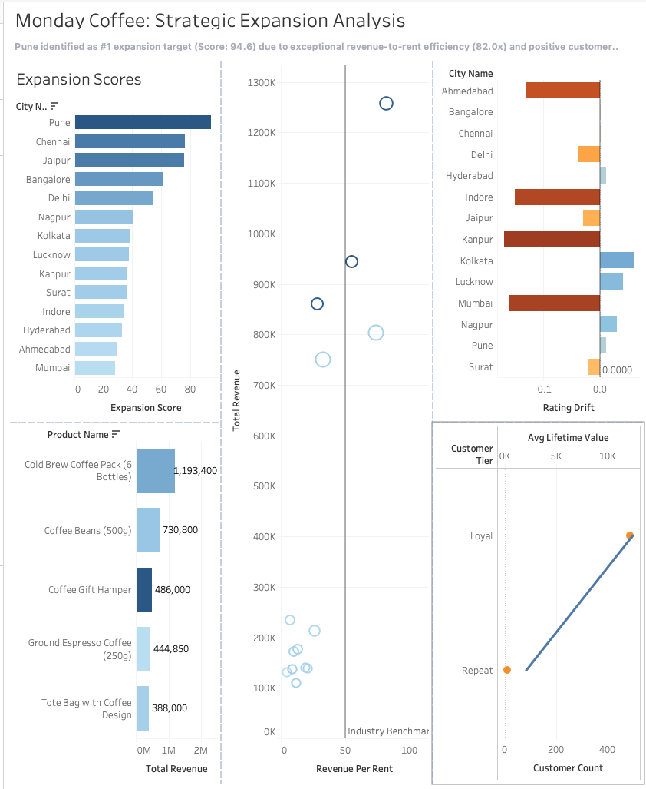

# Monday Koffee: Strategic Retail Expansion Analytics

  
  
  
  

  <strong>From Raw Data to Boardroom Strategy: An End-to-End Data Engineering & Analytics Pipeline</strong>

  

---

## Dashboard Preview
*(Click the image above or the link to interact with the live dashboard!)*

---

## Executive Summary
This project delivers a production-grade data pipeline to identify the optimal city for Monday Coffee's next retail expansion. By engineering a robust data warehouse and applying a custom weighted scoring algorithm to **10,388 transactions** across 14 cities, the model identified **Pune** as the undisputed #1 expansion target.

**The Bottom Line:** Pune delivers a **94.6/100 Expansion Score**, driven by an exceptional **82.0x revenue-to-rent efficiency** and positive customer satisfaction momentum, representing the highest risk-adjusted return for capital deployment.

---

## Key Business Insights
| Metric | Insight | Business Action |
| :--- | :--- | :--- |
| **Top Market** | **Pune** (Score: 94.6) generates ₹82 in revenue for every ₹1 of rent. | **Greenlight** immediate site selection and lease negotiations in Pune. |
| **Revenue Drivers** | "Cold Brew Coffee Pack" (₹1.19M) & "Coffee Beans" (₹730K) dominate. | Prioritize inventory and supply chain logistics for these top SKUs in the new location. |
| **Customer LTV** | 488 "Loyal" customers average **21.2 orders** and ₹12,401 Lifetime Value. | Launch a localized loyalty/subscription program in the new market to replicate this behavior. |
| **Risk Flag** | **Jaipur** has high efficiency (74.0x) but negative rating drift (-0.03). | **Pause** expansion here; conduct a localized operational audit before committing capital. |

---

## System Architecture
This project follows a modern, modular 5-phase data pipeline:

```mermaid
graph LR
    A["📂 Raw CSVs (4 Files)"] -->|Pandas ETL & Validation| B["🗄️ SQLite Warehouse (4 Tables)"]
    B -->|5 Advanced SQL Views| C["📊 Analytics Layer (CTEs, Window Functions)"]
    C -->|Custom Python Scoring| D["🧠 Predictive Model (Expansion Scores)"]
    D -->|CSV Exports| E["📈 Tableau Public (Interactive Dashboard)"]
    
    style A fill:#f9f9f9,stroke:#333,stroke-width:2px
    style B fill:#e1f5fe,stroke:#0288d1,stroke-width:2px
    style C fill:#fff3e0,stroke:#f57c00,stroke-width:2px
    style D fill:#e8f5e9,stroke:#388e3c,stroke-width:2px
    style E fill:#fce4ec,stroke:#c2185b,stroke-width:2px
```

-- 

## Connect With Me

If you found this project insightful, let's connect! I'm always open to discussing data engineering, analytics, and building scalable data products.

LinkedIn: https://www.linkedin.com/in/srivastav-nilesh-4b909b446/?lipi=urn%3Ali%3Apage%3Ad_flagship3_profile_view_base_contact_details%3BoA3ipT%2B9TOK1lkH4L3oSfw%3D%3D
Email: nileshsrivastava00@gmail.com